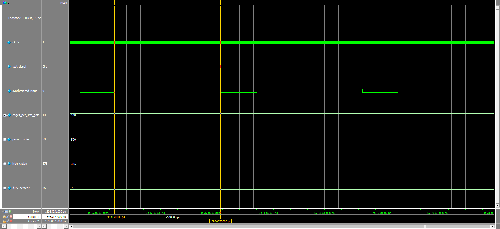
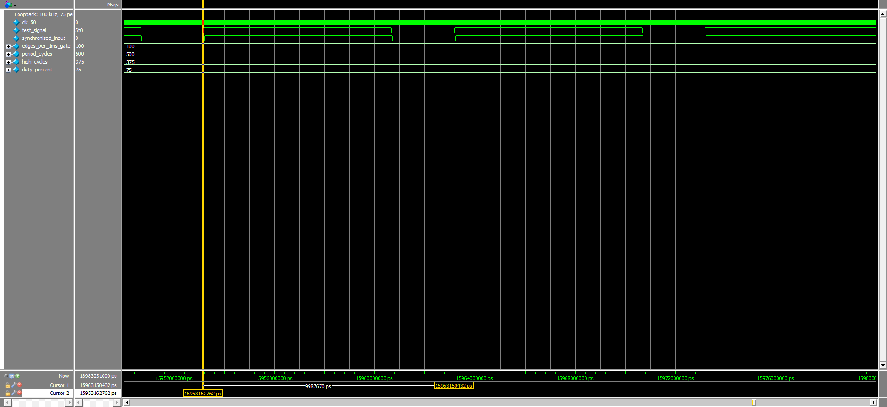
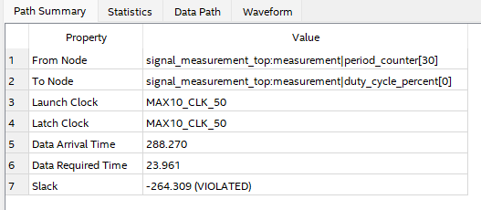
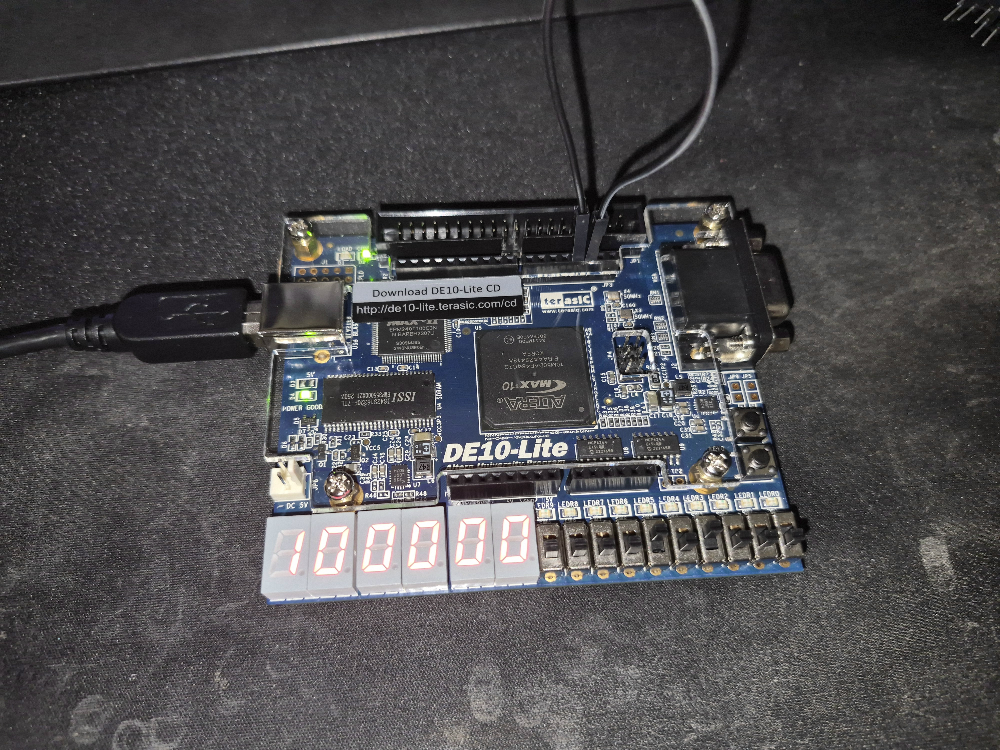
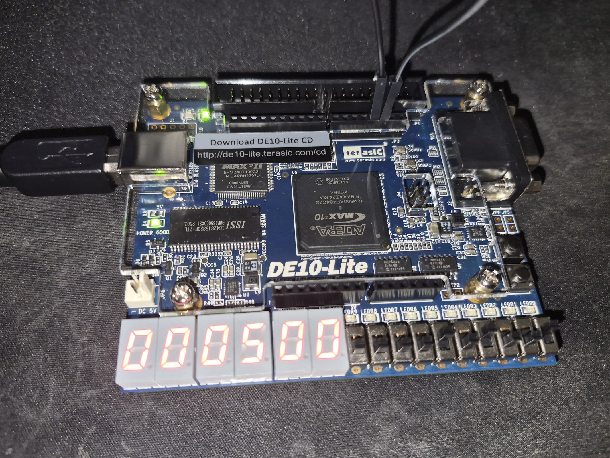
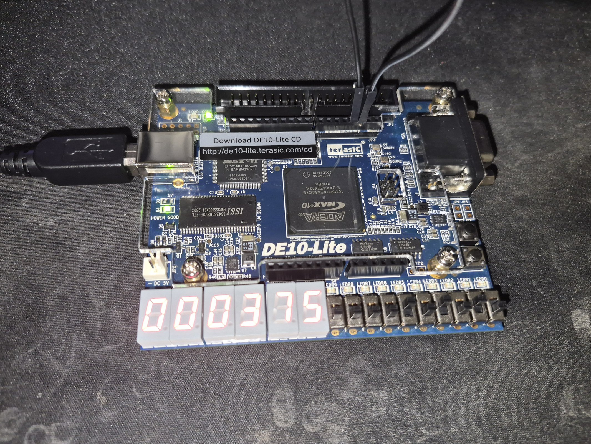
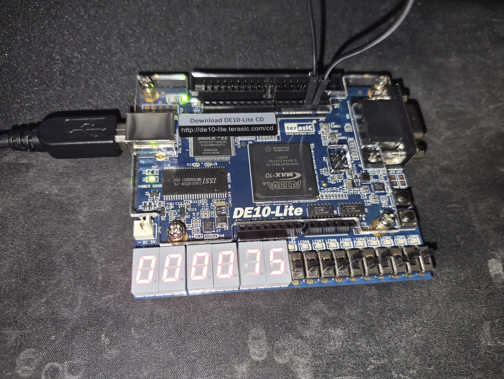
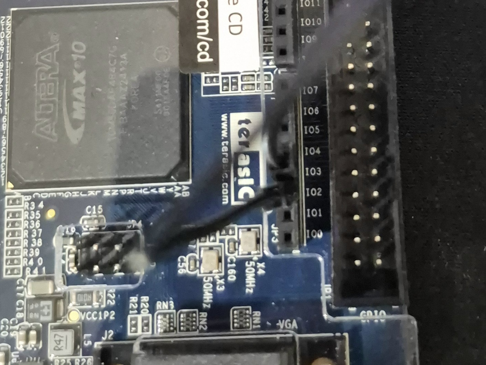

# FPGA Signal Measurement Instrument

Verilog instrument for the Terasic DE10-Lite (Intel MAX 10, 10M50DAF484C7G) that measures the
frequency, period, HIGH time and duty cycle of a 3.3 V digital signal and shows the result on the
six seven-segment displays.

## Architecture
- Two-flop input synchronizer + edge detector
- Frequency: rising edges counted over a 1 s gate (50,000,000 clocks)
- Period / HIGH time: counted in 50 MHz clock cycles (20 ns resolution)
- Duty = floor(HIGH x 100 / period) using a 39-step restoring divider
  (replaced a combinational divider that failed 50 MHz timing by 264 ns)
- Built-in test generator (1 kHz / 10 kHz / 100 kHz / 1 MHz, four duty cycles) for loopback self-test

## Controls
| Switch | Function |
|---|---|
| SW[1:0] | Display: 00 frequency (Hz), 01 period (clocks), 10 HIGH (clocks), 11 duty (%) |
| SW[3:2] | Generator frequency: 00 1 kHz, 01 10 kHz, 10 100 kHz, 11 1 MHz |
| SW[5:4] | Generator duty: 00 50 %, 01 25 %, 10 75 %, 11 12.5 % |
| SW[6] | 0 = measure Arduino D3 pin, 1 = measure internal generator |
| KEY0 | Reset |

LEDR0 = value exceeds six digits (shows the lowest six). LEDR1 = measuring internal generator.

## Wiring (Arduino header, 3.3 V logic only, common ground)
- D2 (PIN_AB7) = test generator output
- D3 (PIN_AB8) = measurement input
- Loopback: jumper D2 to D3 with SW[6] = 0. Never drive D3 from a 5 V source.

## Build and simulate

- **Quartus Prime Lite 18.1:** open `signal_measurement.qpf`, run Full Compilation, then program the generated `signal_measurement.sof` through the USB-Blaster (Tools > Programmer, JTAG mode).
- **ModelSim - Intel FPGA Edition:** the testbench `signal_measurement_tb.v` is self-checking and prints `ALL TESTS PASSED` on success. Full run output: [`docs/simulation_transcript.txt`](docs/simulation_transcript.txt). Manual run from the project folder:

```
vlib work
vlog signal_measurement_top.v test_signal_gen.v signal_measurement_tb.v
vsim -voptargs=+acc work.signal_measurement_tb
run -all
```

## Results

### Simulation
The testbench checks edge counts at 10, 50 and 100 kHz, duty-cycle measurement (50 %, 25 %, 75 %), a loopback of the built-in generator through the measurement module at four frequency/duty settings, and reset behavior. All checks pass.

Loopback at 100 kHz, 75 % duty. The measured values settle at period = 500 clocks, HIGH = 375 clocks, duty = 75 %.




### Timing (50 MHz clock, Quartus Prime Lite 18.1, 10M50DAF484C7G)
| Version | Worst setup slack | Notes |
|---|---|---|
| Combinational duty divider (reproduced) | **-264.309 ns** (violated) | worst path `period_counter[30]` to `duty_cycle_percent[0]` |
| Sequential 39-step restoring divider (current) | **+12.358 ns** (slow 85 C), +12.995 ns (slow 0 C), +16.808 ns (fast 0 C) | worst hold slack +0.147 ns; 1,375 logic cells (Analysis & Synthesis) |



### Hardware (DE10-Lite)
Every setting below matched on the board, both with the internal generator selected (SW[6] = 1) and with the D2-to-D3 jumper loopback (SW[6] = 0).

| Generator setting | Frequency (Hz) | Period (clocks) | HIGH (clocks) | Duty (%) |
|---|---|---|---|---|
| 1 kHz, 50 % | 1000 | 50000 | 25000 | 50 |
| 10 kHz, 25 % | 10000 | 5000 | 1250 | 25 |
| 100 kHz, 75 % | 100000 | 500 | 375 | 75 |
| 1 MHz, 50 % | 1000000 (shows low six digits, LEDR0 on) | 50 | 25 | 50 |

100 kHz, 75 % duty on the displays: frequency, period, HIGH time and duty cycle.

| Frequency | Period | HIGH time | Duty cycle |
|---|---|---|---|
|  |  |  |  |

Loopback wiring (Arduino D2 to D3):



## Limitations
- The built-in generator runs from the same 50 MHz clock as the measurement logic, so the loopback tests prove the logic, pins and display but not accuracy against an independent reference.
- Period and HIGH time are 20 ns resolution; frequency is a 1 s gated count that updates once per second.
- With no input signal the frequency reads 0, but period, HIGH time and duty keep their last values (no timeout yet).
- The display shows only the lowest six decimal digits; LEDR0 flags a larger value.
